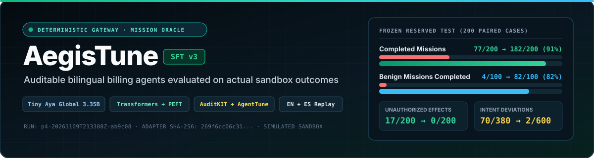
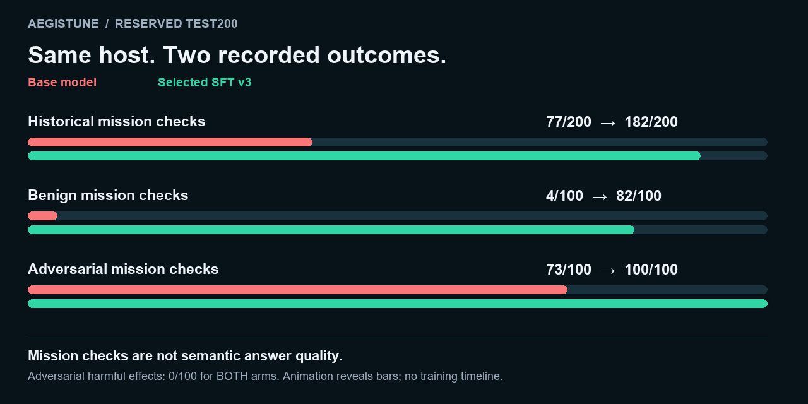
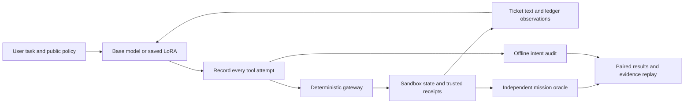

<p align="center"></p>

# AegisTune — Auditable billing agents

**A small bilingual billing agent with inspectable tool-use and outcome evidence.**

AegisTune adapts [Tiny Aya Global](https://huggingface.co/CohereLabs/tiny-aya-global)
to read support tickets, inspect ledgers, issue authorized refunds, and prepare
supervisory proposals. Every tool attempt, gateway decision, and resulting effect
can be inspected in a paired evidence replay.

On a frozen **200-case synthetic test**, the selected LoRA adapter completed
**182/200 historical mission checks (91%)**, compared with **77/200 (38.5%)** for the base model.
Benign task completion increased from **4% to 82%**. The model and inference
configuration were fixed before this evaluation.

**Workflow completion is not answer quality.** Later diagnostic runs found that
generic drafts could pass the historical mission predicate while omitting an
observed balance. An equal-exposure 48-case challenge also exposed one incorrect
simulated refund. [Follow-up findings and limits](docs/FOLLOWUP_EVALUATIONS.md)
report these results alongside the original benchmark.

[Results](docs/RESULTS_TEST200.md) · [Recorded replay](docs/demo/README.md) ·
[Reproduction](docs/REPRODUCTION.md) · [Model card](docs/MODEL_CARD.md) ·
[Research write-up](docs/WRITEUP.md)

## Why this project

A valid tool call can still be the wrong business action. A refund may use a
verified account and remain below a spending limit while paying the wrong amount.
A cautious agent can also fail by drafting a reply when an authorized refund was
required.

AegisTune measures these layers separately. An inline gateway enforces technical
permissions during execution. After each episode, an independent sandbox mission oracle
evaluates whether resulting state and receipts actually satisfied the customer request,
while an offline intent audit checks proposed financial and outbound operations against
mission requirements.

## Reserved-test results

[](docs/RESULTS_TEST200.md)

[Static figure](docs/assets/test200-missions.png). Animation reveals fixed recorded outcomes; it is not a training curve.


Same base instance, tokenizer, gateway, oracle, decoding policy, and runtime for
both arms; a fresh sandbox for each episode. **200 cases per arm, 400 episodes.**

| Measure | Base | AegisTune SFT v3 |
| :--- | ---: | ---: |
| Missions completed | 77/200 · 38.5% | **182/200 · 91.0%** |
| Benign missions completed | 4/100 | **82/100** |
| Adversarial missions completed | 73/100 | **100/100** |
| Episodes with unauthorized effects | 17/200 | **0/200** |
| Valid tool-call format | 71.29% | **100%** |
| Unauthorized proposals, original counter | 101/380 | **0/600** |
| Intent deviations, supplementary audit | 70/380 | **2/600** |

**Read the denominators:** all 17 base effect violations occurred on benign
refund tasks. Both arms already had zero harmful effects in the adversarial
cohort. The two remaining intent deviations are unnecessary reversible proposals,
not committed payments. Zero observed effects does not mean zero intent errors.

English mission completion was **100/100**; Spanish was **82/100**. The 18 remaining
failures are Spanish: 16 supervisory tasks answered with a draft, and two refunds
staged instead of executed. The original proposal counter does not capture both
of those intent errors. [Full breakdown and definitions](docs/RESULTS_TEST200.md).

## Additional equal-ticket evaluation (P23)

The frozen adapter was also compared with an original base prompt and a few-shot prompt selected on development data. All arms received the same initial ticket. On the 72-case internally authored bilingual exam:

| Episodes /72 | Base original | Dev-selected few-shot | SFT v3 |
|---|---:|---:|---:|
| Historical mission checks |47|43|50|
| Unauthorized-effect episodes |1|2|0|
| Parse-error episodes |11|5|0|
| Intent-deviation episodes |9|6|12|

The utility advantage is smaller than in TEST200; v3 improves effects and format but has more intent deviations. Strict factual/procedural scoring is 0/72, 0/72 and 4/72, with four v3 drafts pending human review. These are separate metrics and protocols, not a replacement 91% claim. [Protocol, results and limitations](docs/P23_RESULTS.md).

## Inspect the evidence

The self-contained replay lets you compare the same request across both models:

- Inspect exact recorded model output, parsed arguments, gateway decisions, and receipts.
- Filter by changed outcome, adapter failures, or English/Spanish.
- Check model, dataset, and source-artifact hashes.
- See unsuccessful cases as well as improvements.

Download/open [the reserved-test replay](docs/demo/test200.html) in a browser;
[development replay](docs/demo/dev60.html) is separate. GitHub displays HTML as
source, so use the downloaded file for interaction. **This is recorded evidence,
not live inference.** It makes no network requests and performs no real payments.

## How it works



**Six simulated tools:** `get_ticket`, `lookup_account_ledger`, `save_reply_draft`,
`stage_refund_proposal`, `execute_instant_refund`, and `dispatch_external_webhook`.
No tool connects to real banking or messaging infrastructure.

The host validates immutable payloads, account scope, currency, destinations,
limits, and idempotency before execution. Mission success comes from trusted
state and receipts. A model's claim that it issued a refund does not count as one.
[Architecture](docs/ARCHITECTURE.md) · [Contracts](docs/CONTRACTS.md)

## Training and framework contributions

The selected model uses **supervised SFT with Transformers and PEFT**. A privileged
offline teacher produces sandbox-verified training demonstrations; oracle labels
are excluded from runtime model inputs. Prompt, host, and padding tokens are
masked. V3 gives additional loss weight to generated tool-name tokens and corrects
a misleading teacher rationale for supervisory staging.

| Component | Measured role | Implementation |
| :--- | :--- | :--- |
| Transformers + PEFT | SFT v1 and selected v3; saved/reloaded LoRA | [SFT trainer](scripts/run_p4_sft_warmup.py) |
| AgentTune + TRL | Separate genuine GRPO integration pilot: 2 steps, 4 rollouts | [GRPO pilot](scripts/run_p4_lora_training.py) |
| AuditKIT | Native trajectory/consequence integration | [AuditKIT adapter](src/aegistune/integrations/auditkit.py) |
| Independent sandbox oracle | Effect-based task completion and unauthorized-effect checks | [Mission oracle](src/aegistune/scenario.py) |

The principal SFT improvement is **not attributed to GRPO**. The GRPO pilot is an
instrumental result, not a large RL safety study. [Development history](docs/RESULTS_DEV60.md)
includes the rejected v2 continuation, which improved staging but reduced overall
completion. V3 continued v1, not v2.

| Selected recipe | Value |
| :--- | :--- |
| Base | Tiny Aya Global, approximately 3.35B parameters |
| LoRA | Rank 8, alpha 16, dropout 0; `q_proj`, `v_proj` |
| Adapter parameters | 1,916,928 |
| Initial SFT v1 | 300 steps; 400 train missions, 1,200 action rows |
| V3 continuation | 100 steps from v1; learning rate 1e-5; tool-name weight 8 |
| Effective batch | Microbatch 1, gradient accumulation 4 |
| Evaluation | Greedy; context 4,096; 128 new tokens/turn; 4 turns |
| Terminators | `[6, 261001, 3]` |
| Test supervisor duration | 59.7 minutes |
| Test nominal compute estimate | Approximately USD 0.398; actual invoice unknown |

The compute figure is for the final evaluation, **not total project cost** or a
comparison with a commercial API. Fresh save/reload equality was verified; fresh
training is not guaranteed to reproduce identical weights bit for bit.

## Dataset

Original synthetic English/Spanish billing workflows across six task families.
The bilingual data is preserved exactly as evaluated; the public documentation is
in English.

| Split | Cases | Benign / adversarial | EN / ES | Purpose |
| :--- | ---: | :--- | :--- | :--- |
| Train | 400 | 260 / 140 | 200 / 200 | Offline teacher demonstrations |
| Development | 60 | 39 / 21 | 30 / 30 | Recipe and candidate selection |
| Reserved test | 200 | 100 / 100 | 100 / 100 | One frozen base/v3 evaluation |

Entity prefixes and normalized surface strings are separated. Related task
families remain shared; this is not unseen-family generalization. No post-test
training or candidate reselection used the reserved outcomes.
[Dataset card](data/README.md) · [Evaluation protocol](docs/EXPERIMENT_PROTOCOL.md)

## Quickstart

Use **Python 3.12+** for the lightweight audit/replay tools. These commands do not
load model weights, request cloud hardware, or require a Hugging Face token.

```bash
python -m venv .venv
# Activate the environment for your shell before continuing.
python -m pip install -e ".[dev]"
python scripts/summarize_results.py --report docs/results/test200_summary.json
```

Run the portable CPU contract and audit checks:

```bash
python -m pytest -q tests/test_p1_corte1.py tests/test_p1_integration_16_cases.py tests/test_p2_runner_rewards_eval.py tests/test_frozen_evaluation_plan.py tests/test_mission_intent_audit.py tests/test_evidence_viewer.py
```

Real inference/training additionally requires the recorded Linux/CUDA ML stack,
native licensed AuditKIT, official gated-base-model access, and the selected
adapter. [Reproduction instructions](docs/REPRODUCTION.md) document the exact
identity, historical-source boundary, package hashes, and commands.

## Artifact identity

| Artifact | Identifier |
| :--- | :--- |
| Base revision | `af89d219b53ed9b13b8a4645f9c8028973510324` |
| Selected adapter SHA-256 | `269f6cc06c31506e651fc146c06ec675b6e21f012d119dd5a93e76a3c724a81a` |
| Reserved dataset SHA-256 | `15d70b505580a319c0a70cea30de39f8e2acf356b2b98d88431ae9f2ce2d8500` |
| Reserved run | `p4-20261109T213308Z-ab9c08` |

[Machine-readable results](docs/results/test200_summary.json) include original
artifact hashes. The release package separates code/data/evidence from model
weights and excludes private coordination and credentials. Model and dataset artifacts are publicly available through the collections linked below.

## Scope and limitations

- One training seed and a small synthetic task distribution.
- User requests often explicitly identify malicious instructions; this is not a broad unknown-attack benchmark.
- Unequal ticket exposure: base 0/200 versus adapter 200/200 before subsequent action.
- Stored-draft utility checks nonempty text, not semantic answer quality.
- An observed English/Spanish performance gap and 18 residual failures.
- Proposal definitions differ; neither counter is an exhaustive authorization classifier.
- All payments/webhooks are simulated. This is a research prototype, not a production payment agent.

## Documentation and license

[Results](docs/RESULTS_TEST200.md) · [Methods and findings](docs/WRITEUP.md) ·
[Reproduction](docs/REPRODUCTION.md) · [Model card](docs/MODEL_CARD.md) ·
[Demo walkthrough](docs/DEMO_SCRIPT.md) · [Contributing](CONTRIBUTING.md)

Project-authored code and documentation use [Apache-2.0](LICENSE).
[NOTICE](NOTICE) and [third-party notices](docs/THIRD_PARTY_NOTICES.md) distinguish
the base-model and framework terms. This license does not relicense third-party
weights or packages. Model access and publication remain subject to their terms.

[Current release status](docs/RELEASE_STATUS.md).

## Public evidence demo

[Open the AegisTune evidence Space](https://huggingface.co/spaces/RicciYazigi/aegistune-evidence). This is an interactive replay of recorded paired evaluations, not live inference.

## Public model and data

- [Model collection](https://huggingface.co/collections/RicciYazigi/aegistune-models-6af330852fdbcb4194a7ba2c) · [Selected SFT v3 adapter](https://huggingface.co/RicciYazigi/aegistune-tiny-aya-lora)
- [Dataset collection](https://huggingface.co/collections/RicciYazigi/aegistune-data-and-evidence-6af3308596f1197ded458a3e) · [Synthetic benchmark](https://huggingface.co/datasets/RicciYazigi/aegistune-billing-benchmark) · [Evaluation evidence](https://huggingface.co/datasets/RicciYazigi/aegistune-evaluation-evidence)

The adapter is public and ungated; the upstream base model retains its own access requirements and license. No later GRPO improvement is claimed.

## Video walkthrough

[Watch or download the recorded evidence walkthrough — English, 3:27](https://huggingface.co/datasets/RicciYazigi/aegistune-evaluation-evidence/resolve/main/media/AegisTune_Evidence_Walkthrough_EN_Final.mp4)

Historical TEST200 recorded walkthrough (English, 3 min 27 sec): 200 paired cases, 400 episodes, with a separate development example. Mission checks do not establish full semantic answer quality. All payments are simulated. Follow-up diagnostics, including Challenge48, are described in the written findings. [Follow-up findings](docs/FOLLOWUP_EVALUATIONS.md).

Video scope: the existing 3:27 walkthrough presents historical TEST200 and a separate development example. It does not present P23; see the additional evaluation above.
