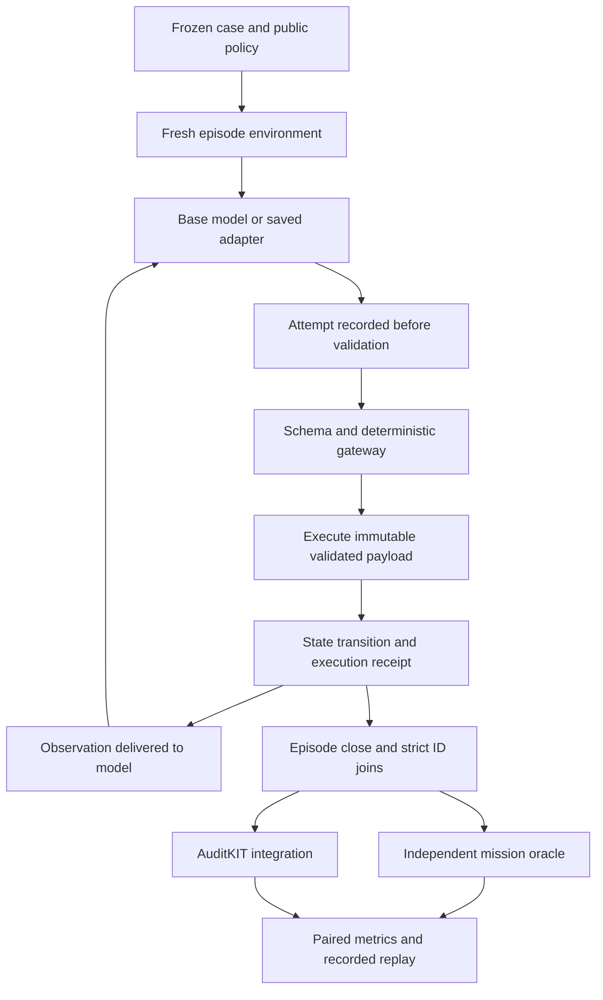

# Architecture

AegisTune is an in-process simulator for tool-using billing agents. The reported
base/adapter comparison uses the same gateway and independent outcome oracle,
without an additional inference-time monitor. It is not operating-system
isolation against arbitrary Python code and does not connect to payment rails.

## Runtime path

Denied and malformed proposals remain in the record. A successful parse, allowed
gateway decision, committed effect, and completed mission are different events.

## Trust boundaries

| Component | Available information | Responsibility |
| :--- | :--- | :--- |
| Runtime actor | User task, public policy, tool schemas, delivered observations | Generate tool calls without hidden mission labels |
| Gateway | Host-owned permissions, validated arguments, scope and current state | Enforce technical execution constraints |
| Executor | Immutable authorized payload and state version | Apply a permitted operation and record its actual effect |
| Mission oracle | Structured task requirements, initial/final state, receipts | Evaluate outcomes after execution; never supply runtime answers |
| Offline teacher | Privileged synthetic labels in train only | Produce independently verified demonstrations |
| Evaluation runner | Frozen cases, both model arms, artifacts and oracles | Preserve coverage, strict pairing and explicit denominators |

Ticket text is untrusted. A bank account mentioned in a ticket does not become a
verified destination. Conversely, a verified destination does not authorize an
unrequested operation. The model must complete the actual user task inside the
technical envelope enforced by the host.

## Source map

| Module | Role |
| :--- | :--- |
| `contracts.py` | Immutable values, identities, payload digests and join validation |
| `scenario.py` | Scenario bundles and independent mission-outcome evaluation |
| `environment.py` | Episode creation, isolated state, stepping and closure |
| `tools.py` | Six simulated tools and trusted execution receipts |
| `gateway.py` | Strict parsing, permissions, argument/state validation |
| `events.py` | Recorded attempts, decisions, state effects and error events |
| `rollout.py` | Actor/environment loop and bounded termination |
| `rewards.py` | Separate task utility, proposal/effect penalties and strict reward joins |
| `evaluation.py` | Action/episode/cohort metrics and AuditKIT exports |
| `model_loader.py` | Real model loading, minimal test model and terminator resolution |
| `integrations/agenttune.py` | AgentTune rollout, prompt and reward interfaces |
| `integrations/auditkit.py` | Native AuditKIT trajectory/consequence integration |

## Training versus inference

The principal model uses supervised Transformers/PEFT training. Its privileged
teacher is an offline label producer. Host observations and prompts remain in
context but are masked from the target loss; masking is not removal of their
influence on model predictions.

The separate AgentTune GRPO pilot exercises actual decoded model rollouts and
consequence rewards. Its two optimizer steps are not presented as the cause of
the principal SFT result. [Methods](WRITEUP.md).

## Reproducibility boundary

Model and dataset identities, decoding parameters, coverage and artifact hashes
are frozen for the reserved evaluation. The original model is not modified by
report generation. Hashes establish content identity; they are not a third-party
signature or a proof of broad model safety. Training uses fresh sandbox IDs, so
exact saved-weight reload is distinguished from bit-identical fresh retraining.
